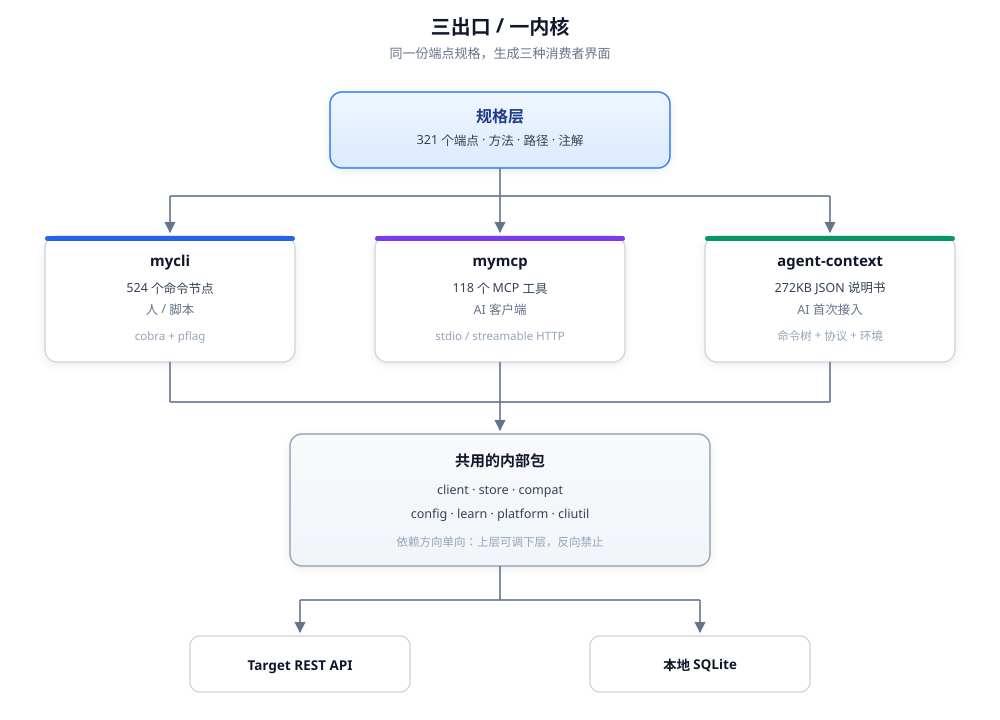
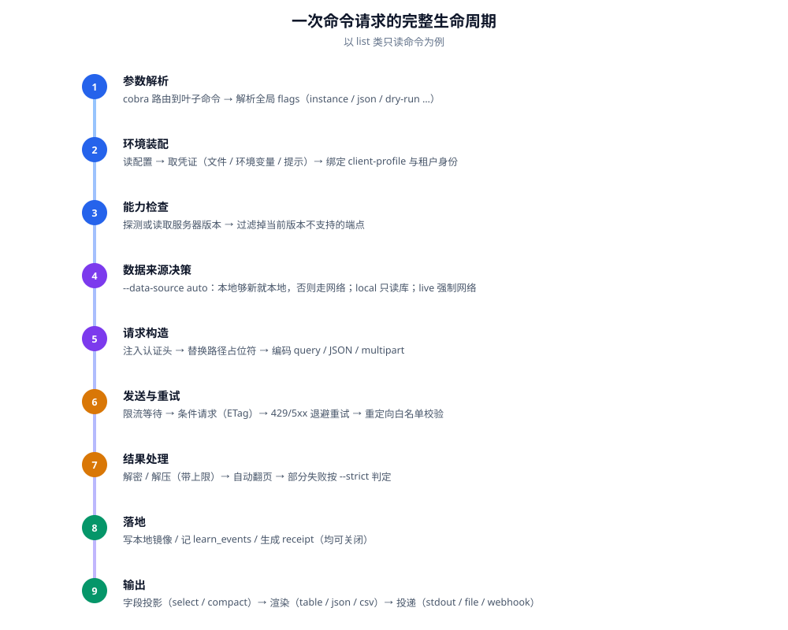
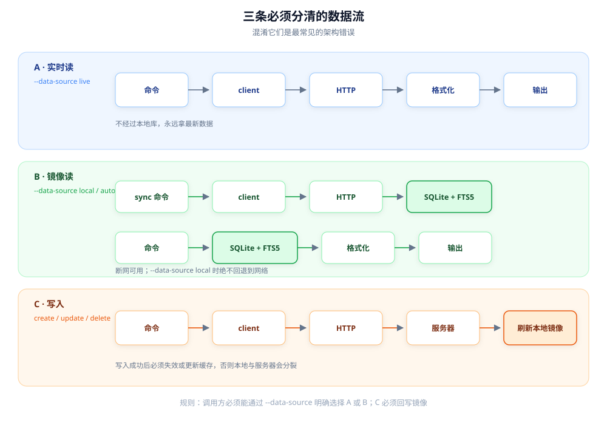

# 01 - 总体架构

## 1. 三个出口，一个内核



**核心事实**（buildinfo 实测）：

```
mycli.exe   path = mycli/cmd/mycli
mymcp.exe   path = mycli/cmd/mymcp
              mod  = mycli
launcher   mod  = launcher          （独立模块，只共享配置文件）
```

前两个是同一个模块的两个入口，**不是进程间调用**。

---

## 2. 内部包边界

```
mycli/
├── cmd/
│   ├── mycli/        入口：参数解析 → 执行 → 输出
│   └── mymcp/        入口：注册工具 → 起 transport
└── internal/
    ├── cli/                   每个叶子命令一个包（admin_printers_list/ ...）
    ├── client/                HTTP、重试、缓存、限流、上传下载
    ├── store/                 SQLite schema、查询、FTS、迁移
    ├── learn/                 召回、候选、playbook、事件
    ├── compat/                版本探测、端点门控
    ├── config/                ~/.instances.yml 读取与校验
    ├── platform/              profile、doctor、限流预算、会话
    └── cliutil/               路径、凭证、原子写、输出辅助
```

依赖方向必须单向：

```
cli  ──►  client / store / learn / compat / config / platform / cliutil
                  ▲
                  └── 下层不能反向 import cli
```

**规范**：

- **必须**让 `internal/cli/*` 只做三件事：参数绑定、调用下层、格式化返回。
- **必须**把 HTTP 相关逻辑全部留在 `client`，命令包里不得直接 `http.Get`。
- **应该**让 `store` 不知道 HTTP 的存在，只接受"资源类型 + 数据"。
- **可以**让 `learn` 依赖 `store`，但不得依赖 `cli`。

---

## 3. 一次命令请求的完整生命周期

以 `mycli dashboards list --agent` 为例：



---

## 4. 三条数据流必须分清



三条路径的适用场景：

- **A 实时读**：要最新数据、一次性查询。
- **B 镜像读**：离线、批量分析、全文搜索。
- **C 写入**：创建、更新、删除。

**规范**：

- **必须**让调用方能用 `--data-source` 明确区分 A 和 B。
- **必须**让 C 在成功后刷新或失效本地镜像，否则数据会分裂。
- **禁止**在 `local` 模式下静默回退到网络——用户选 local 就是不想要网络。

---

## 5. 目录约定（实测）

| 用途 | Windows 实际路径 |
|---|---|
| 配置 | `C:\Users\<u>\.config\mycli` |
| 数据 | `C:\Users\<u>\.local\share\mycli`（`data.db`） |
| 状态 | `C:\Users\<u>\.local\state\mycli` |
| 缓存 | `C:\Users\<u>\.cache\mycli` |

遵循 XDG 约定，在 Windows 上也用同样的相对结构。

**规范**：

- **必须**把可删除的（缓存）和不可删除的（配置）分目录。
- **应该**把数据库放 `data`，把日志/游标/临时状态放 `state`。
- **禁止**把凭证写进 `cache`。

---

## 6. 依赖选择（实测）

`mymcp` 只有 22 个第三方模块：

| 类别 | 依赖 | 说明 |
|---|---|---|
| CLI 框架 | `spf13/cobra` `pflag` | 命令树、参数 |
| MCP 协议 | `mark3labs/mcp-go` | stdio + HTTP transport |
| Schema | `santhosh-tekuri/jsonschema/v6`、`google/jsonschema-go` | 参数校验 |
| 路径模板 | `yosida95/uritemplate/v3` | `/api/{id}` 替换 |
| 存储 | `modernc.org/sqlite` | 纯 Go，无 CGO |
| 配置 | `gopkg.in/yaml.v3`、`pelletier/go-toml` | YAML/TOML |
| 杂项 | `google/uuid`、`dustin/go-humanize` | ID、可读大小 |

**值得学的地方**：

- 选 **纯 Go 的 SQLite**，交叉编译不用带 CGO，四个平台一套构建。
- **不引入重量级 HTTP 框架**，用标准库 `net/http` + `crypto/tls`，减少攻击面。
- 依赖总数少，供应链风险低。

---

## 7. 架构上做得好的三点

1. **入口极薄**。`cmd/*` 只负责装配，业务都在 `internal`，所以 CLI 和 MCP 能复用。
2. **横切能力集中在 `client` 和 `cliutil`**。不是每个命令各写一遍重试和限流。
3. **元数据层独立于执行层**。加接口不用改执行代码。

## 8. 架构上的风险

| 风险 | 表现 |
|---|---|
| `internal/cli` 目录爆炸 | 每个叶子一个包，524 个节点 → 几百个目录，IDE 索引慢 |
| 生成代码可读性差 | 出问题时要回到规格层排查，而不是看命令包 |
| 隐式行为多 | 自动缓存、自动学习、自动限流，排障需要工具（`doctor`、`--dry-run`） |
| 二进制体积 | 28/33MB，因为全量端点 + 静态编译 |

---

## 检查清单

- [ ] CLI 和 MCP 是否共享同一份底层代码，而不是互相 exec？
- [ ] 下层包是否完全不知道上层的存在？
- [ ] 实时读、镜像读、写三条路径是否显式可区分？
- [ ] 配置/数据/状态/缓存是否分目录？
- [ ] 新增一个端点，是否需要改超过两个文件？
