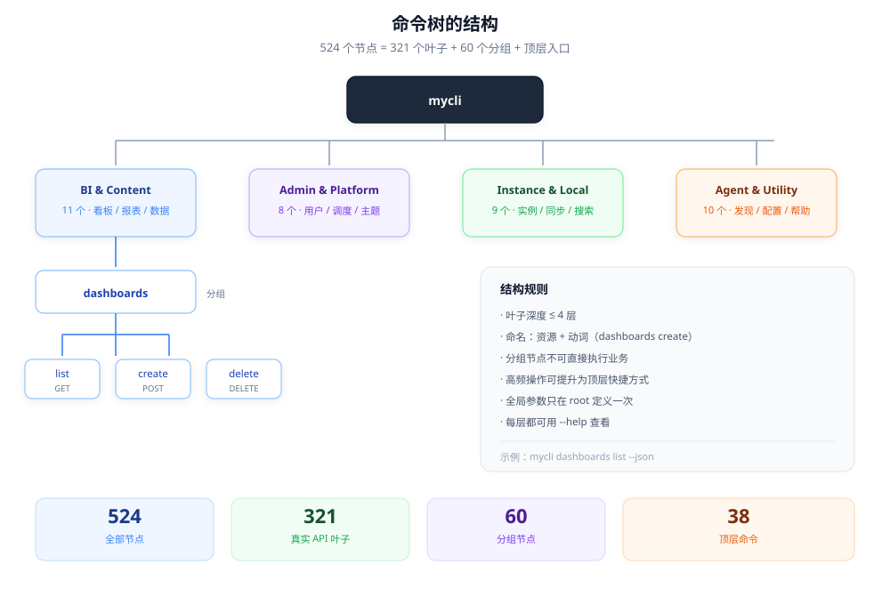

# 03 - 命令树设计

## 1. 实测规模



38 个顶层命令按用途分成四组（`--help` 里的分组标题）：

```
BI & Content Commands        11 个   dashboards / reports / datasets ...
Admin & Platform Commands     8 个   admin / identity / scheduler ...
Instance, Auth & Local Store      9 个   auth / instance / sync / search ...
Agent & CLI Utility Commands     10 个   agent-context / api / which / profile ...
```

**第一个值得学的点**：帮助输出不是平铺 38 行，而是按**用户意图**分组。分组标题本身就是导航。

---

## 2. 树形结构的原则

### 2.1 深度控制在 2-4 层

实测典型结构：

```
mycli dashboards list                     ← 2 层叶子
mycli datasets native query-data          ← 3 层叶子
mycli admin knowledge-base search         ← 3 层叶子
```

**规范**：

- **必须**让叶子命令深度 ≤ 4。
- **禁止**出现 `a b c d e` 这种 5 层结构——用户记不住，AI 也容易选错。
- **应该**用"资源 → 动作"两段式，第三段只在资源本身有子类型时才用（比如 `datasets native`）。

### 2.2 分组节点必须不可执行，或者给出提示

实测注解：

```
pp:parent-group: "true"   → 这是分组
runnable: true            → 但也能执行（打印子命令列表）
```

**规范**：

- **应该**让分组节点可执行时，行为是"打印子命令列表 + 提示"，而不是报错。
- **必须**在 `--help` 里区分"分组"和"命令"。

### 2.3 顶层快捷方式

实测 `api` 的说明：

> Promoted top-level commands cover single-endpoint shortcuts.
> This command lists resource parents that group multiple endpoints.

意思是：有些高频端点被**提升到顶层**，其余放在分组里。

**规范**：

- **可以**把最高频的 5-10 个操作提升为顶层命令。
- **必须**保证提升后的命令仍然能通过完整路径访问（别名，不是移动）。
- **禁止**因为"顶层好看"把低频命令也提上来。

---

## 3. 命名规范

### 3.1 命令名

| 规则 | 例子 | 反例 |
|---|---|---|
| 全小写，单词用连字符 | `query-data` | `queryData`、`query_data` |
| 动词在后 | `dashboards create` | `create-dashboard` |
| 避免缩写 | `knowledge-base` | `kb` |
| 不用复数不一致 | 固定用资源原名 | `dashboard list` |

**为什么动词在后**：资源是主语，用户先在脑子里定位"哪个东西"，再想"要干什么"。这个顺序和自动补全的体验一致。

### 3.2 参数名

实测风格：

```
--instance-name    --resource-type    --document-ids
--dry-run          --allow-partial-failure
```

规则：

- 全小写 + 连字符
- 布尔参数用形容词或动词短语（`--dry-run`、`--ignore-missing`）
- 列表参数用复数（`--document-ids`）
- 避免和全局参数重名

### 3.3 必须是全局长选项

- **必须**给每个 flag 提供长选项，不要只给单字母。
- **可以**为高频 flag 提供单字母（实测：`-i` instance、`-y` yes、`-v` version）。
- **禁止**让短选项在不同命令里含义不同。

---

## 4. 参数分层落地

```
┌─────────────────────────────────────────────┐
│ 全局层（root persistent flags）              │
│ --instance --server-version --json --csv    │
│ --timeout --dry-run --no-input --yes ...    │
├─────────────────────────────────────────────┤
│ 分组层（分组 persistent flags）              │
│ 只在该资源下有意义的参数                      │
├─────────────────────────────────────────────┤
│ 动作层（叶子 local flags）                    │
│ --id --name --stdin --file ...              │
└─────────────────────────────────────────────┘
```

**规范**：

- **必须**把跨所有命令的参数放全局层，实现一次、处处可用。
- **应该**让全局参数可以被 profile 覆盖（见下）。
- **禁止**在叶子命令里重复定义全局参数。

---

## 5. Profile：把一组参数存成名字

实测语义：

```
profile save <name>     把当前这次调用里的非默认 flags 存下来
profile use <name>      只打印会应用的值，不执行
profile list            列出
profile show <name>     看某个的完整值
profile delete <name>   删除
--profile <name>        在任何命令上应用
```

关键设计：

- **只存非默认值**（"captures the current invocation's set flags"）——不会把一堆默认值灌进去。
- **显式 flag 覆盖 profile**——命令行优先级最高。
- **`use` 只打印不执行**——可以先确认再用。

**规范**：

- **必须**只持久化显式设置的值。
- **必须**定义优先级：命令行 > profile > 配置 > 内置默认。
- **应该**提供"只看不跑"的子命令。
- **禁止**把凭证类参数存进 profile。实测原话：

  > store credential-like flags: %s; use --client-profile with exact external references

  也就是说：检测到像凭证的参数时，拒绝保存，要求改用外部引用。

---

## 6. 发现机制：三个入口解决"我不知道用哪个命令"

这套系统有三层发现，值得完整借鉴：

### 入口 A：`--help`（人类）

分组标题 + 简短描述。

### 入口 B：`which <自然语言>`（人 + AI）

```
mycli which "stale tickets"
mycli which "bottleneck"
mycli which --limit 1 "send message"
mycli which                    # 列出完整能力索引
```

实测退出码规范：

```
0  至少一个匹配
2  没有可信匹配（机器输出仍然写 {"matches":[]}）
```

**值得学的点**：搜索失败也是一个**明确的、可编程的结果**，不是异常。

### 入口 C：`agent-context`（AI）

272KB JSON，包含完整命令树、全局参数、路径、协议。

**规范**：

- **必须**为 AI 提供一个"一次拿全"的入口，不要让它逐个 `--help`。
- **应该**让搜索类命令在无结果时返回结构化空结果 + 非零退出码。
- **可以**让搜索支持 `--limit` 和多种输出格式。

---

## 7. `api` 命令：原始接口逃生口

实测说明：

> Browse API resource interfaces using their raw command names.
> Run `api` with no arguments to list those interfaces.

作用：当规格生成的命令名不好用、或者用户知道原始接口名时，能直接按接口浏览。

**规范**：

- **应该**提供两个逃生口：
  - 按**接口名**浏览（`api <interface>`）
  - 按**端点 ID** 直接执行（MCP 的 `mycli_execute`）
- **必须**让逃生口也走同一套认证、限流、错误处理，不能绕开安全层。

---

## 8. 命令树的测试策略

因为命令是生成的，测试也应该生成：

| 测试 | 内容 |
|---|---|
| 快照测试 | 命令树结构变化时，diff 是否可解释 |
| 一致性测试 | 规格里的必填参数 == `--help` 里的必填参数 |
| 只读性测试 | `mcp:read-only` 的叶子命令不得发出非 GET 请求 |
| 命名测试 | 所有叶子名符合 kebab-case |
| 深度测试 | 所有叶子深度 ≤ 4 |
| 可用性测试 | 每个有 `happy-args` 的命令能被 dry-run 成功构造 |

**规范**：

- **必须**有"规格 → 生成物"的一致性测试。
- **应该**把命令树快照纳入 code review。

---

## 检查清单

- [ ] 顶层命令是否按用户意图分组，而不是平铺？
- [ ] 叶子命令深度是否 ≤ 4？
- [ ] 命令名是否统一"资源 + 动词"？
- [ ] 全局参数是否只定义一次？
- [ ] profile 是否只保存显式值，并拒绝凭证？
- [ ] 是否有 `which` / `agent-context` 这类发现入口？
- [ ] 搜索无结果时是否返回结构化空结果？
- [ ] 是否有按原始接口名调用的逃生口？
