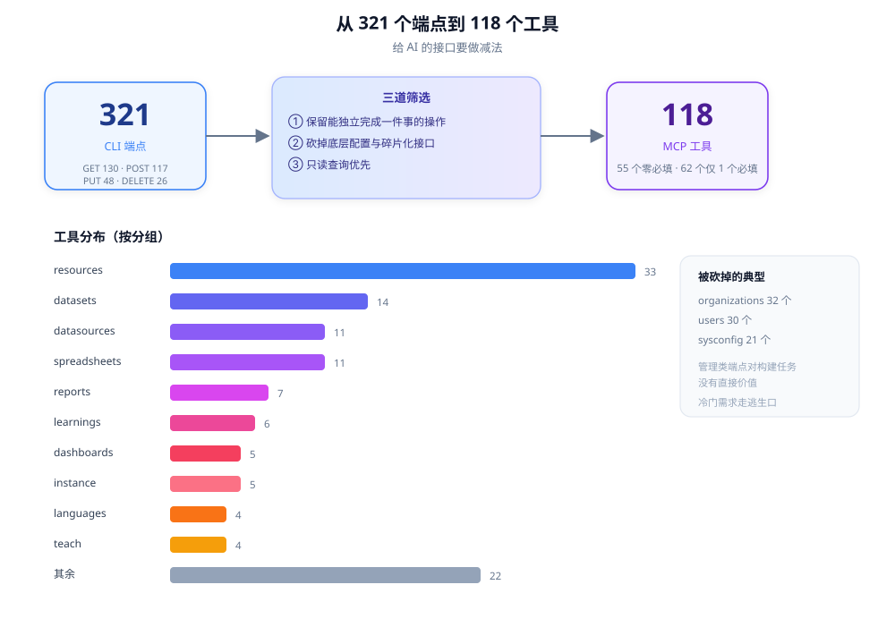

# 07 - MCP 工具层

> CLI 面向人，MCP 面向 AI。同一个内核，但界面设计完全不同。

---

## 1. 协议基础

实测握手：

```
客户端 → initialize            (protocolVersion / clientInfo / capabilities)
客户端 → notifications/initialized
客户端 → tools/list            → 118 个工具定义
客户端 → tools/call            → 执行
```

服务端信息：

```json
{"name": "mymcp", "version": "0.2.12", "protocolVersion": "2024-11-05"}
```

能力声明只有 `tools`（没有 resources / prompts / sampling）。

**规范**：

- **必须**在 `initialize` 里如实声明能力，不要声明了却不实现。
- **应该**只实现真正需要的功能，`tools` 通常就够。

---

## 2. 传输方式

实测参数：

```
-transport stdio            默认，适合本地 AI 客户端
-transport http             默认绑定 127.0.0.1:7777
-addr host:port             改绑定地址
-tls-cert / -tls-key        非回环地址必需
```

规则：

```
stdio → 无网络暴露，最安全，首选
http + 127.0.0.1 → 本机客户端共享（多个 AI 工具同时连）
http + 非回环    → 必须 TLS，否则拒绝启动
```

**规范**：

- **必须**默认 stdio。
- **必须**在绑定非回环地址时强制 TLS。
- **应该**在启动日志里打印实际监听地址和传输方式。
- **禁止**默认监听 `0.0.0.0`。

---

## 3. 从 321 个端点挑出 118 个工具



### 3.1 实测分布

| 分组 | 工具数 | 占端点比例 |
|---|---:|---|
| `resources_*` | 33 | 主题/字体/地图/图层等素材 |
| `datasets_*` | 14 | 5 种数据集类型 |
| `datasources_*` | 11 | 连接与查询 |
| `spreadsheets_*` | 11 | 表格文件 |
| `reports_*` | 7 | 报表 |
| `learnings_*` | 6 | 经验库 |
| `dashboards_*` | 5 | 看板 |
| `instance_*` | 5 | 实例切换 |
| `teach_*` | 4 | 教学 |
| 其余 | 22 | context/sql/sync/search/tail/... |

对比 CLI：`organizations` 32 个端点、`users` 30 个端点，在 MCP 里几乎不出现。

### 3.2 选取原则

```
保留：
  · 构建类操作（创建看板/报表/数据集）
  · 常用查询（列表、详情）
  · 完整的"做一件事"闭环

砍掉：
  · 底层配置（sysconfig 21 个端点）
  · 用户/组织管理（除非 AI 需要）
  · 碎片化的单字段更新
  · 需要多步才能完成的中间步骤

优先：
  · 只读查询
```

**规范**：

- **必须**让每个工具都能**独立完成一件用户能理解的事**。
- **必须**砍掉需要"先调 A 再调 B 才能用"的工具，除非封装成一个。
- **应该**把高频但复杂的操作封装成**复合工具**（比如 `datasets_native_query_data` 一条龙）。
- **禁止**把 API 端点一一对应暴露。

### 3.3 复合工具的例子

实测 `workflow_archive`：

> Sync all resources to local store for offline access and search

这一个工具背后可能是几十个同步请求 + 本地写入。对 AI 来说，"归档所有资源"是一个动作。

---

## 4. 工具命名

```
CLI:  mycli datasets native query-data
MCP:  datasets_native_query_data
```

规则：

- 资源名 + 子类型 + 动作，用 `_` 连接
- 全小写
- 不超过 ~48 字符
- 动词放最后

**规范**：

- **必须**和 CLI 命令保持机械可转换（见 [02](02-spec-model.md)）。
- **应该**让名字本身能表达"对什么做什么"。
- **禁止**用 `exec` / `run` / `call` 这种无信息量的词。

---

## 5. inputSchema 的生成

MCP 工具定义的核心是 `inputSchema`（JSON Schema）。

```json
{
  "name": "dashboards_create",
  "description": "Create a new Dashboard (.dbd) from a JSON/.dbd file, stdin, or blank template",
  "inputSchema": {
    "type": "object",
    "properties": {
      "file":  {"type": "string", "description": "Path to a .dbd or JSON file"},
      "stdin": {"type": "boolean", "description": "Read body as JSON from stdin"},
      "name":  {"type": "string", "description": "Dashboard name"}
    },
    "required": ["name"]
  },
  "annotations": {
    "readOnlyHint": false,
    "destructiveHint": true,
    "idempotentHint": false,
    "openWorldHint": true
  }
}
```

### 实测的必填参数分布

```
0 个必填：55 个工具
1 个必填：62 个工具
2 个必填： 1 个工具
```

**这个分布不是巧合，是刻意的设计目标。**

**规范**：

- **必须**把必填参数压到 1-2 个。
- **必须**给每个参数写 `description`（AI 靠它理解用法）。
- **应该**给枚举参数列出 `enum`。
- **应该**用 `default` 表达常见默认值。
- **可以**提供 `file` + `stdin` 双入口，避免 AI 拼长 JSON。

---

## 6. 参数复用 CLI 全局参数

每个工具的参数里都有：

```
instance, instance-user, server-version, timeout, select,
compact, dry-run, json, yes, no-input, no-cache, ...
```

**为什么这么做**：

1. AI 需要和人类相同的控制能力（比如 `dry-run` 先试）
2. 不用重新设计一套 AI 专用参数
3. 生成器直接用同一份 flag 定义

**规范**：

- **必须**让 AI 能访问关键的安全参数（`dry-run`、`yes`）。
- **应该**把通用参数标记为 `optional`，并给出合理默认值。

---

## 7. annotations（MCP 标准注解）

实测 118 个工具**全部**带注解：

```json
{
  "readOnlyHint": true,
  "destructiveHint": false,
  "idempotentHint": false,
  "openWorldHint": true
}
```

四个字段的实际含义：

| 字段 | 含义 | 对 AI 的影响 |
|---|---|---|
| `readOnlyHint` | 不改变服务器状态 | 可以放心调用 |
| `destructiveHint` | 可能删除/覆盖数据 | 调用前应该问用户 |
| `idempotentHint` | 重复调用结果相同 | 可以安全重试 |
| `openWorldHint` | 访问外部系统 | 注意网络副作用 |

**规范**：

- **必须**给每个工具标注 `readOnlyHint` 和 `destructiveHint`。
- **必须**让注解和实际行为一致（这是安全承诺，不是装饰）。
- **应该**在生成阶段从规格的 `mcp:read-only` 自动派生，不要手写。

---

## 8. `context` 工具：把提示词变成协议

实测返回 21KB JSON，字段：

```
api, archetype, auth, compatibility, description,
instance_protocol, learn_protocol, paths,
query_tips, resources, server_version,
server_version_source, tool_count, tool_surface
```

### 8.1 关键字段说明

| 字段 | 作用 |
|---|---|
| `auth` | 告诉 AI 用什么凭证、从哪读 |
| `compatibility` | 当前能用的端点数量、被门控的数量 |
| `instance_protocol` | **行为规范**：先确认实例、没配置怎么办 |
| `learn_protocol` | **行为规范**：先查经验、空库怎么短路 |
| `paths` | 配置/数据/状态/缓存目录 |
| `query_tips` | 查询技巧 |
| `resources` | 54 个资源类目 |
| `tool_count` / `tool_surface` | 工具清单摘要 |

### 8.2 `instance_protocol` 的实际内容（翻译）

```
1. 目标实例解析与确认（每会话一次）：
   a. 跑 instance current/lists
   b. 有配置文件 → 用指定的实例/用户；多个且未指定 → 问用户
   c. 无配置文件 → 默认 http://localhost:51980
   d. 没有 token → 向用户要，并给出保存方式
```

### 8.3 `learn_protocol` 的实际内容（部分）

```
1. Recall first：回答领域问题前先查经验
   （并警告：不要把用户输入拼进 shell 命令行）
2. Empty-store short-circuit：如果库是空的，后续跳过 recall
```

**规范**：

- **必须**提供一个"一次拿全上下文"的工具。
- **必须**把行为规范写成**可读的编号步骤**，不要写成散文。
- **应该**把路径、认证方式、兼容性这些"环境事实"也放进去。
- **可以**在协议里写明安全注意事项（比如不要拼接 shell）。

---

## 9. 隐藏工具

实测 `mcp:hidden` 注解（2 个）。

用途：命令存在，但不暴露给 AI。

**规范**：

- **应该**隐藏：内部调试、危险的管理操作、实验性功能。
- **必须**保证隐藏只是"不列出"，不是"禁止调用"——权限控制应该另有机制。

---

## 10. 错误返回

MCP 的工具调用结果里有 `isError` 字段。

```json
{
  "content": [{"type": "text", "text": "..."}],
  "isError": true
}
```

**规范**：

- **必须**区分"工具执行失败"（`isError: true`）和"协议错误"（JSON-RPC error）。
- **必须**让错误文本包含可操作的下一步。
- **应该**在可能时返回结构化 JSON，而不是纯文本。
- **禁止**把堆栈直接返回给模型。

---

## 11. 工具描述怎么写（实测风格）

好的例子：

```
Create a new Dashboard (.dbd) from a JSON/.dbd file, stdin, or blank template
```

拆解：

```
动词     Create
对象     a new Dashboard (.dbd)
输入形式 from a JSON/.dbd file, stdin, or blank template
```

差的写法：

```
Creates a dashboard.
```

**规范**：

- **必须**写清楚"对什么、用什么输入、产出什么"。
- **应该**在描述里带上关键接口路径（实测很多工具描述里写了 `via POST /api/v2/...`），方便排查。
- **禁止**写"管理 XX"这种没有动作信息的描述。

---

## 12. 最小实现骨架（mcp-go）

```go
s := server.NewMCPServer("my-mcp", "0.1.0",
    server.WithToolCapabilities(true),
)

for _, ep := range spec.Endpoints {
    tool := mcp.NewTool(toolName(ep),
        mcp.WithDescription(ep.Summary),
        mcp.WithReadOnlyHintAnnotation(ep.Annotations.ReadOnly),
        mcp.WithDestructiveHintAnnotation(!ep.Annotations.ReadOnly),
        mcp.WithBoolean("dry-run", mcp.Description("Preview without sending")),
        // ... 其余参数
    )
    s.AddTool(tool, func(ctx context.Context, req mcp.CallToolRequest) (*mcp.CallToolResult, error) {
        return runEndpoint(ctx, ep, req)
    })
}

switch transport {
case "stdio":
    server.ServeStdio(s)
case "http":
    httpServer := server.NewStreamableHTTPServer(s)
    if !isLoopback(addr) && (cert == "" || key == "") {
        return fmt.Errorf("non-loopback --addr requires --tls-cert and --tls-key")
    }
    return httpServer.StartTLS(addr, cert, key)
}
```

---

## 检查清单

- [ ] 默认传输是 stdio？
- [ ] 非回环地址是否强制 TLS？
- [ ] 工具数量是否做了减法，而不是端点直出？
- [ ] 每个工具是否能独立完成一件事？
- [ ] 必填参数是否 ≤ 2？
- [ ] 每个参数是否有 description？
- [ ] 每个工具是否带 `readOnlyHint` / `destructiveHint`？
- [ ] 是否有 `context` 类工具提供环境与行为规范？
- [ ] 工具描述是否写清"输入 → 输出"？
- [ ] 错误是否结构化且带下一步？
