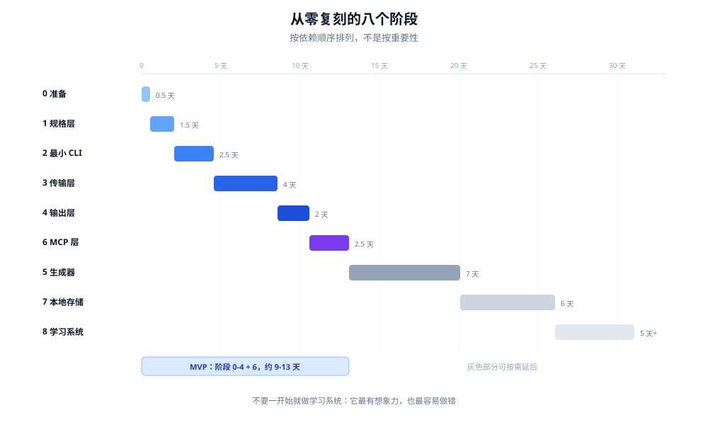

# 13 - 从零复刻：八个阶段

> 这一章是动手路线。每个阶段都有明确的验收标准，做完再过下一关。



---

## 阶段 0：准备（0.5 天）

### 目标

选一个目标系统，确认值得做。

### 判断公式

```
端点数 × 变化频率 × 消费方数量 > 100 ?
```

- 端点数 < 20：手写更划算
- 只有一个消费方（人）：只做 CLI
- 只有一个消费方（AI）：只做 MCP
- 没有离线需求：跳过本地存储

### 产出

```
目标 API 的 OpenAPI/Swagger 规格
一份"我们要支持哪些端点"的白名单
```

### 常见错误

- 不加筛选地全量导入 → 后面工具太多，AI 选不对
- 规格版本和目标服务器版本不一致

---

## 阶段 1：规格层（1-2 天）

### 目标

把端点写成结构化数据。

### 产出

```
spec/
├── endpoints/
│   ├── dashboards.yaml
│   ├── datasets.yaml
│   └── ...
└── schemas/
```

单条规格：

```yaml
endpoint: dashboards.list
method: GET
path: /api/v2/dashboards
summary: List or search Dashboards
params:
  query:
    - {name: keyword, type: string, required: false}
    - {name: page, type: int, default: 1}
annotations:
  mcp:read-only: true
  pp:happy-args: {keyword: "sales"}
compat:
  min_version: "9.1"
```

### 验收标准

- [ ] 每条规格都有 `endpoint` / `method` / `path` / `summary`
- [ ] 每个参数都有 `type` 和 `description`
- [ ] 只读性已标注
- [ ] 版本要求已标注
- [ ] 有校验脚本能跑通

### 常见错误

- 参数名直接照搬 OpenAPI 的驼峰（`userId`），后面还得转换
- 把"父分组"也写成端点

---

## 阶段 2：最小 CLI（2-3 天）

### 目标

**只做一条命令**，跑通完整链路。

```
mycli dashboards list --json
```

### 产出

```
cmd/mycli/main.go
internal/
├── cli/dashboards_list/
├── client/client.go
├── config/config.go
└── output/output.go
```

### 最小代码

```go
// cmd/mycli/main.go
func main() {
    root := &cobra.Command{Use: "mycli"}
    root.PersistentFlags().String("instance", "", "target instance")
    root.PersistentFlags().Bool("json", false, "JSON output")
    root.PersistentFlags().Bool("dry-run", false, "preview only")
    root.PersistentFlags().Bool("no-input", false, "never prompt")

    root.AddCommand(dashboards.NewCmd())
    if err := root.Execute(); err != nil {
        os.Exit(exitCode(err))
    }
}
```

```go
// internal/cli/dashboards_list/cmd.go
func NewCmd() *cobra.Command {
    var keyword string
    cmd := &cobra.Command{
        Use:   "list",
        Short: "List Dashboards",
        RunE: func(cmd *cobra.Command, _ []string) error {
            ctx := cmd.Context()
            c, err := client.New(ctx)
            if err != nil { return err }

            resp, err := c.Get(ctx, "/api/v2/dashboards", map[string]string{
                "keyword": keyword,
            })
            if err != nil { return err }

            return output.Render(resp, output.OptionsFrom(cmd.Flags()))
        },
    }
    cmd.Flags().StringVar(&keyword, "keyword", "", "search keyword")
    return cmd
}
```

### 验收标准

- [ ] `--json` 输出合法 JSON
- [ ] `--dry-run` 打印请求但不发送
- [ ] 401 时给出配置 token 的指引
- [ ] stdout 只有数据，日志走 stderr
- [ ] 退出码 0/1/2 区分清楚

### 常见错误

- 一上来就写生成器 → 还没搞清一条命令该长什么样
- 把 HTTP 逻辑写进命令包

---

## 阶段 3：传输层（3-5 天）

### 目标

把所有"稳"的能力集中实现一次。

### 产出

```go
type Client struct {
    base     string
    hc       *http.Client
    token    string
    retry    RetryPolicy
    limiter  *AdaptiveLimiter
}
```

功能清单：

```
[ ] 认证头注入
[ ] 超时
[ ] 重试（尊重 Retry-After）
[ ] 条件请求缓存（ETag）
[ ] 自适应限流
[ ] 重定向白名单
[ ] 响应体大小限制
[ ] 错误分类 + Hint
[ ] 流式上传/下载
```

### 验收标准

- [ ] 420/500 会自动重试，4xx（除 429）不重试
- [ ] 重定向到内网被拒绝
- [ ] 故意返回 100MB gzip 会被拦截
- [ ] 每个错误都有 `kind` 和 `hint`

### 常见错误

- 用 `http.DefaultClient`（没有超时，会挂死）
- 重试 POST 但不加幂等键

---

## 阶段 4：输出层（2 天）

### 目标

同一份数据，五种格式。

### 产出

```
output/
├── render.go      选择器
├── table.go       表格（按显示宽度对齐）
├── json.go
├── csv.go
└── projector.go   --select / --compact
```

### 验收标准

- [ ] 中文表格对齐正确
- [ ] `--select a,b` 生效，字段不存在时报错
- [ ] 非 TTY 自动去色
- [ ] `--deliver file:` 能落盘
- [ ] 错误在 `--json` 下也是合法 JSON

### 常见错误

- 用 `len(s)` 算宽度（中文会错位）
- 把进度条输出到 stdout

---

## 阶段 5：生成器（5-10 天）

### 目标

从规格批量生成命令。

### 产出

```
tools/gen/
├── main.go
├── cli.tmpl
└── mcp.tmpl
```

生成内容：

```
internal/cli/<group>_<action>/cmd.go
internal/spec/generated.go     （端点常量、参数定义）
```

### 验收标准

- [ ] 新增一条 YAML，重跑生成器，命令就出现
- [ ] 生成物可重复（同样输入 → 同样输出）
- [ ] 生成物能通过 `go build`
- [ ] 有 CI 检查"规格变了但生成物没更新"

### 常见错误

- 生成器里写业务逻辑
- 生成物手工修改（下次生成会被覆盖）

---

## 阶段 6：MCP 层（2-3 天）

### 目标

用同一份规格注册工具。

### 产出

```go
// cmd/mymcp/main.go
s := server.NewMCPServer("my-mcp", "0.1.0",
    server.WithToolCapabilities(true))

for _, ep := range selectedEndpoints {
    if ep.Annotations.Hidden { continue }   // 减法
    s.AddTool(toTool(ep), handler(ep))
}

if transport == "stdio" {
    server.ServeStdio(s)
} else {
    // 非回环必须 TLS
}
```

### 验收标准

- [ ] `initialize` → `tools/list` 能返回工具
- [ ] 每个工具带 `readOnlyHint` / `destructiveHint`
- [ ] 必填参数 ≤ 2
- [ ] 有一个 `context` 工具返回环境说明
- [ ] stdio 模式可被真实客户端连上

### 常见错误

- 321 个端点全暴露
- 工具描述只有"Creates a xxx."

---

## 阶段 7：本地存储（5-8 天，可选）

### 目标

离线查询 + 全文搜索。

### 产出

```sql
resources(id, resource_type, data, synced_at, updated_at)
resources_fts USING fts5(..., tokenize='trigram')
sync_state(resource_type, last_cursor, last_synced_at,
           total_count, last_attempt_complete)
```

命令：

```
sync     全量/增量同步
search   全文搜索
sql      只读 SQL
```

### 验收标准

- [ ] 增量同步可续传
- [ ] 同步中断后，状态标记为 partial
- [ ] `query_only` 生效，写 SQL 被拒
- [ ] 本地数据绑定租户身份

### 常见错误

- 忘了 `busy_timeout`，两个进程同时访问就报错
- 用默认分词器，中文搜不到

---

## 阶段 8：学习系统（可选，5 天+）

### 目标

把"做对过一次"变成可复用资产。

### 产出

```sql
search_learnings(query_pattern, resource_id, confidence, source, ...)
learn_candidates(signature UNIQUE, sightings, status, ...)
learn_events(event, surface, ...)
```

命令：

```
recall / teach / learnings list|confirm|reject|stats
```

### 验收标准

- [ ] 自动学到的知识**不会**自动生效
- [ ] `confirm` 才写入正式表
- [ ] `reject` 后同一签名不再出现
- [ ] 有命中率统计

### 常见错误

- 跳过隔离区，直接写入
- 不记录 miss，算不出命中率

---

## 横切阶段：随时补

### 版本兼容

在阶段 5 之后加，因为需要生成器支持 `min_version` 过滤。

### 安全加固

在阶段 2 就该开始（凭证处理），在阶段 3 完成（网络），在阶段 6 补齐（MCP 暴露）。

### 可运维性

在阶段 2 加 `--no-input` / `--dry-run` / `--json`，后面所有阶段都受益。

---

## 总时间估算

| 阶段 | 天数 | 可否砍掉 |
|---|---:|---|
| 0 准备 | 0.5 | 否 |
| 1 规格 | 1-2 | 否 |
| 2 最小 CLI | 2-3 | 否 |
| 3 传输层 | 3-5 | 否 |
| 4 输出层 | 2 | 否 |
| 5 生成器 | 5-10 | 端点多才需要 |
| 6 MCP | 2-3 | 只给人用可砍 |
| 7 本地存储 | 5-8 | 无离线需求可砍 |
| 8 学习系统 | 5+ | 可以后期加 |
| **合计** | **22-33 天** | |

**最小可用版本（MVP）**：阶段 0-4 + 6，约 9-13 天。

---

## 目录结构参考

```
mycli/
├── cmd/
│   ├── mycli/                 CLI 入口
│   └── mymcp/                 MCP 入口
├── internal/
│   ├── spec/                  规格加载与类型
│   ├── cli/                   生成的命令（每个一个包）
│   ├── client/                HTTP、重试、缓存、限流
│   ├── store/                 SQLite
│   ├── output/                渲染与投影
│   ├── compat/                版本探测与门控
│   ├── config/                配置
│   ├── learn/                 学习系统
│   └── cliutil/               路径、凭证、原子写
├── spec/
│   └── endpoints/*.yaml
├── tools/
│   └── gen/                   生成器
├── docs/
└── go.mod
```

---

## 每一关的自检问题

做完每个阶段，问自己：

```
1. 这个阶段暴露的能力，有没有对应的关闭开关？
2. 出问题时，用户能不能自己定位？
3. 如果明天要加 10 个端点，我需要改几个文件？
4. 如果对接第二个版本的服务器，我需要改什么？
5. 这段代码有没有把凭证写进日志？
```

---

## 最后：优先级建议

如果时间有限，按这个顺序做：

```
1. 规格层          ← 决定后面所有事
2. 最小 CLI        ← 验证链路
3. 传输层          ← 决定稳定性
4. 输出层          ← 决定可用性
5. MCP 层          ← 决定 AI 能不能用
6. 生成器          ← 决定能不能扩展
7. 本地存储        ← 锦上添花
8. 学习系统        ← 锦上添花
```

**不要**一开始就做学习系统。它是最有想象力的部分，也是最容易做错的部分。
